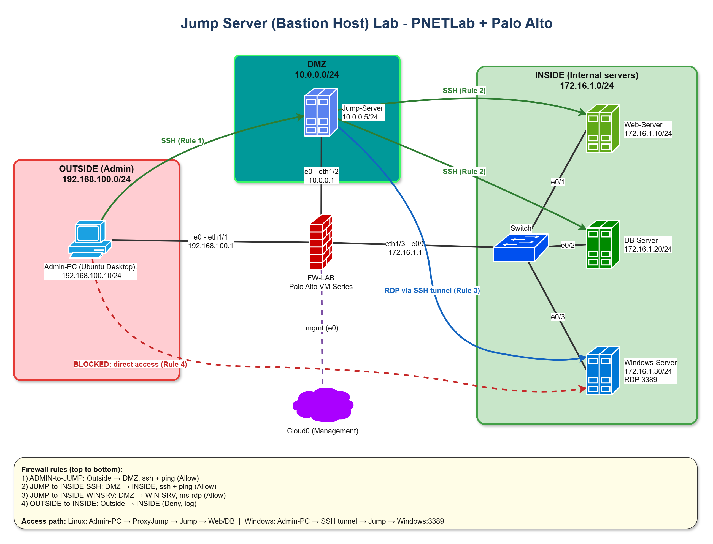
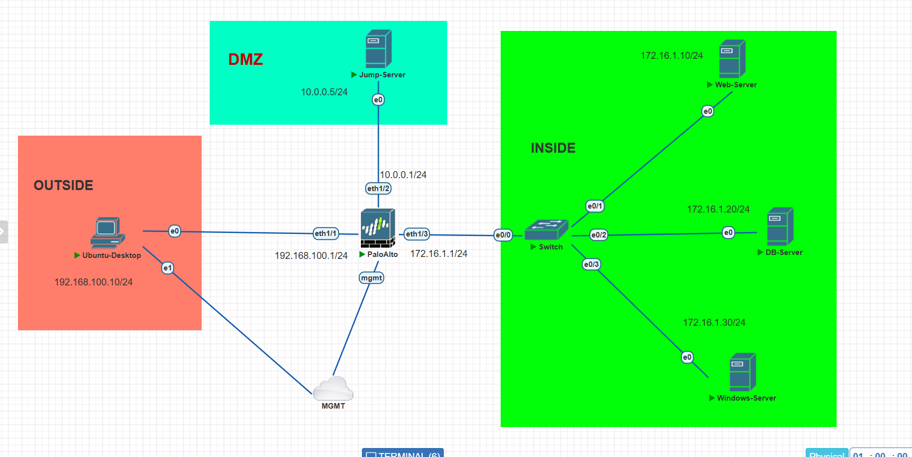
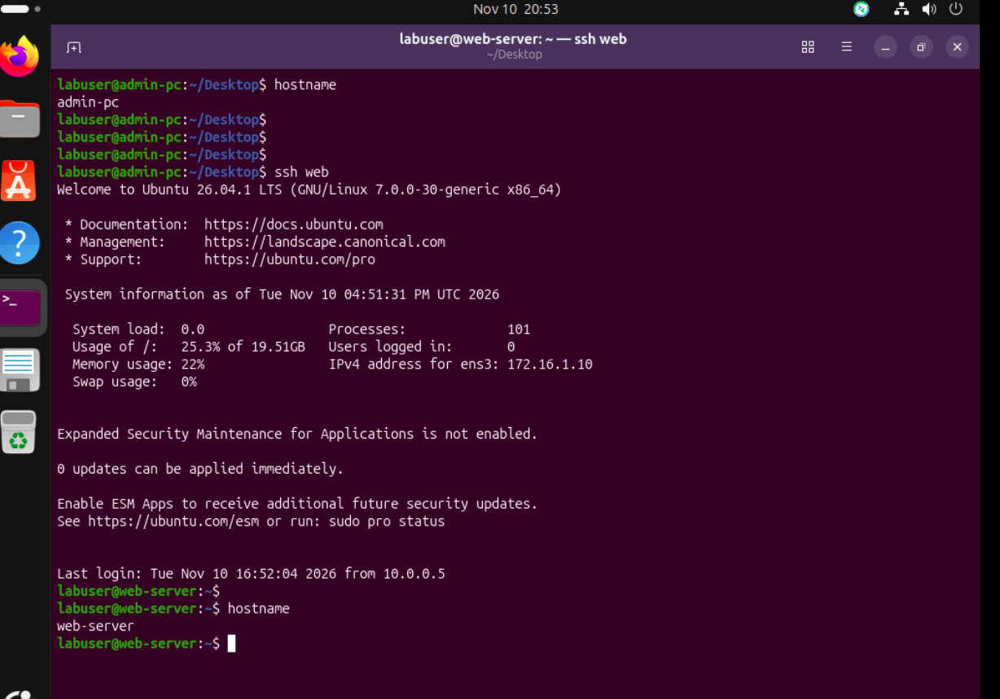
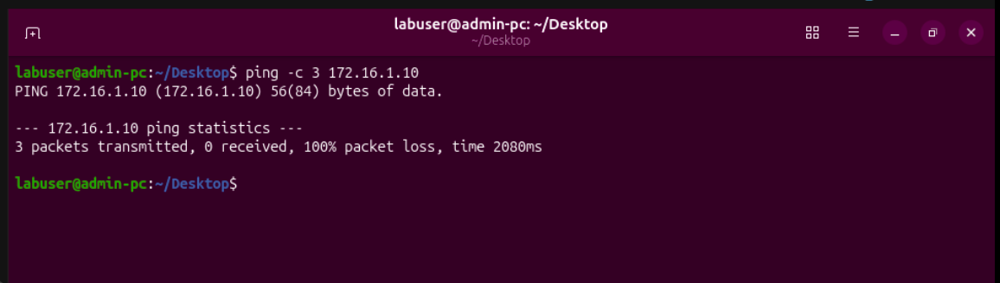
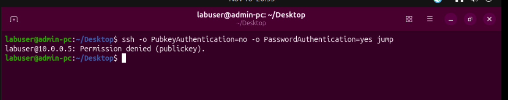
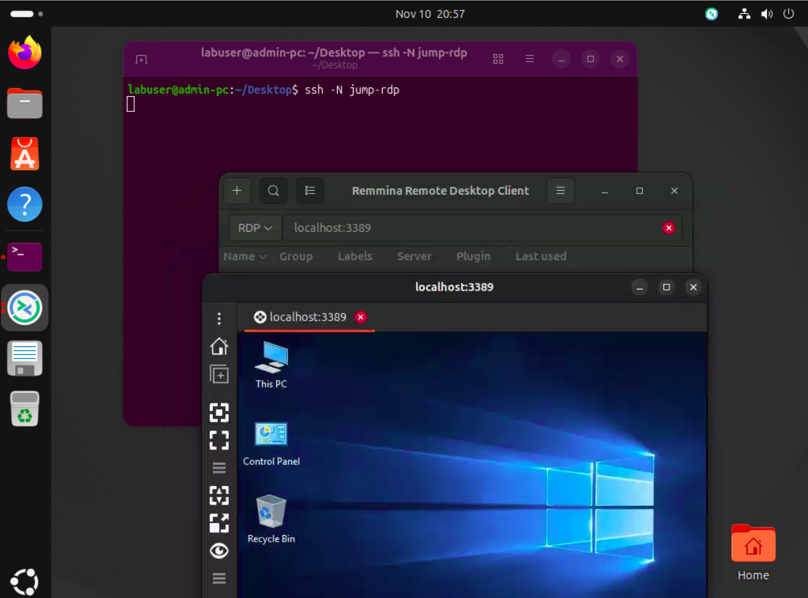
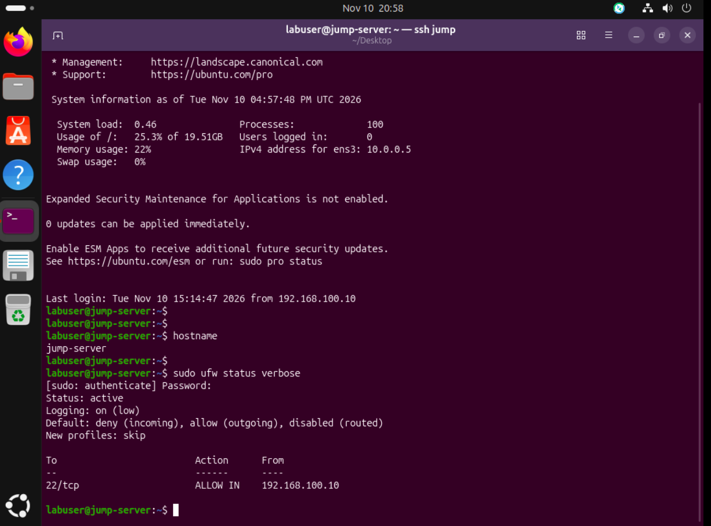
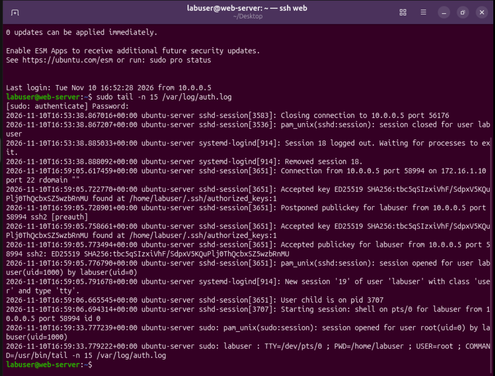
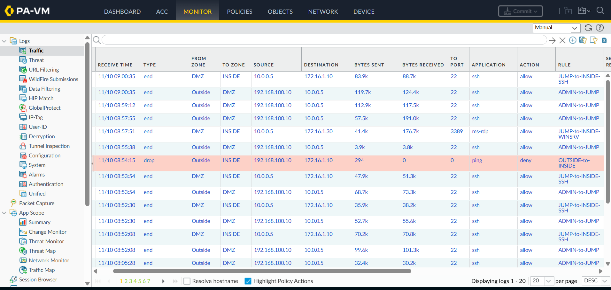

# Jump Server Labı: PNETLab + Palo Alto

[English](README.md) | Azərbaycanca

PNETLab-də qurulmuş kiçik şəbəkə. Daxili serverlərə yalnız tək bir Jump Server vasitəsilə çatmaq olur. Ortada Palo Alto firewall dayanır və nəyin keçib-keçməyəcəyini o həll edir.



## Necə işləyir

Şəbəkə üç zonadan ibarətdir:

- **Outside** (192.168.100.0/24): admin kompüteri.
- **DMZ** (10.0.0.0/24): Jump Server.
- **INSIDE** (172.16.1.0/24): web server, verilənlər bazası serveri və Windows server.

Admin kompüteri INSIDE-dakı heç bir cihaza birbaşa çata bilmir. Server-ə çatmaq üçün admin əvvəl Jump Server-ə qoşulur, Jump Server isə hədəfə keçir. Firewall yalnız bu yola icazə verir. Outside-dan INSIDE-a gedən qalan bütün trafik bloklanır və loglanır.

## IP planı

| Cihaz | İnterfeys | IP ünvan | Zona |
|---|---|---|---|
| Admin-PC (Ubuntu Desktop) | ens3 | 192.168.100.10/24 | Outside |
| Palo Alto | ethernet1/1 | 192.168.100.1/24 | Outside |
| Palo Alto | ethernet1/2 | 10.0.0.1/24 | DMZ |
| Palo Alto | ethernet1/3 | 172.16.1.1/24 | INSIDE |
| Jump-Server (Ubuntu Server) | ens3 | 10.0.0.5/24 | DMZ |
| Web-Server (Ubuntu Server) | ens3 | 172.16.1.10/24 | INSIDE |
| DB-Server (Ubuntu Server) | ens3 | 172.16.1.20/24 | INSIDE |
| Windows-Server | Ethernet | 172.16.1.30/24 | INSIDE |

Firewall-un idarəetmə interfeysi və admin kompüterinin ikinci kartı Cloud0 körpüsünə qoşulub. Bu, yalnız firewall-un veb GUI-sinə və host kompüterdən admin kompüterinə qoşulmaq üçündür. Yuxarıdakı trafik yolunun bir hissəsi deyil.

## Firewall qaydaları

Qaydalar yuxarıdan aşağı oxunur, ona görə DENY qaydası sonda qalmalıdır.

| # | Ad | Haradan | Hara | Tətbiq | Hərəkət |
|---|---|---|---|---|---|
| 1 | ADMIN-to-JUMP | Outside, Admin-PC | DMZ, Jump-Server | ssh, ping | Allow |
| 2 | JUMP-to-INSIDE-SSH | DMZ, Jump-Server | INSIDE, 172.16.1.0/24 | ssh, ping | Allow |
| 3 | JUMP-to-INSIDE-WINSRV | DMZ, Jump-Server | INSIDE, Windows-Server | ms-rdp | Allow |
| 4 | OUTSIDE-to-INSIDE | Outside | INSIDE | any | Deny, log |

Bütün qaydalar `application-default` istifadə edir və session sonunda log yazır.

## Serverlərə giriş

### Linux serverlər

`ProxyJump` ilə SSH. Admin kompüterindəki klient konfiqurasiyası:

```sshconfig
Host jump
  HostName 10.0.0.5
  User labuser
  IdentityFile ~/.ssh/id_ed25519

Host web
  HostName 172.16.1.10
  User labuser
  IdentityFile ~/.ssh/id_ed25519
  ProxyJump jump

Host db
  HostName 172.16.1.20
  User labuser
  IdentityFile ~/.ssh/id_ed25519
  ProxyJump jump
```

`ssh web` əvvəl Jump Server-ə qoşulur, oradan web server-ə davam edir. Gizli açar admin kompüterində qalır. Agent forwarding qəsdən bağlıdır.

### Windows server

RDP, Jump Server-ə SSH tunel ilə daşınır:

```sshconfig
Host jump-rdp
  HostName 10.0.0.5
  User labuser
  IdentityFile ~/.ssh/id_ed25519
  LocalForward 3389 172.16.1.30:3389
```

```bash
ssh -N jump-rdp
```

Sonra RDP klienti (məsələn Remmina) ilə `localhost:3389` ünvanına qoşulmaq lazımdır.

## Sərtləşdirmə

**sshd** (`/etc/ssh/sshd_config.d/00-lab-hardening.conf`):

```
PermitRootLogin no
PasswordAuthentication no
PubkeyAuthentication yes
AllowUsers labuser
MaxAuthTries 3
LoginGraceTime 30
X11Forwarding no
AllowAgentForwarding no
AllowTcpForwarding yes
LogLevel VERBOSE
```

Jump Server-də `AllowTcpForwarding` mütləq `yes` qalmalıdır, yoxsa ProxyJump və RDP tuneli işləmir. Web və DB serverlərində eyni fayl `LoginGraceTime`, `AllowAgentForwarding` və `AllowTcpForwarding` sətirləri olmadan istifadə olunur.

Faylın adı `00-` ilə başlayır ki, `50-cloud-init.conf`-dan əvvəl oxunsun. sshd tapdığı ilk dəyəri istifadə edir, cloud-init faylı isə parolla girişi yenidən aça bilər.

**ufw** hər Linux serverində:

```bash
sudo ufw default deny incoming
sudo ufw default allow outgoing
sudo ufw allow from 192.168.100.10 to any port 22 proto tcp   # Jump-Server: yalnız admin
sudo ufw allow from 10.0.0.5 to any port 22 proto tcp         # Web və DB: yalnız Jump-Server
sudo ufw enable
```

**Windows Firewall:** Remote Desktop gələn qaydası yalnız 10.0.0.5 ilə məhdudlaşdırılıb.

## İşlədiyini yoxlamaq

| Test | Gözlənilən nəticə |
|---|---|
| Admin-PC-dən `ssh jump` | Açarla giriş uğurlu |
| `ssh web`, `ssh db` | Jump Server vasitəsilə uğurlu |
| Admin-PC-dən `ping 172.16.1.10` | Cavab yoxdur. Firewall qayda 4 üzrə `deny` loglayır |
| Yalnız parolla SSH | `Permission denied (publickey)` |
| Tunel açıq olanda `localhost:3389` RDP | Windows masaüstü açılır |
| `sudo ufw status verbose` | Aktivdir, 22-ci port yalnız gözlənilən mənbədən açıqdır |

## Skrinşotlar

**PNETLab topologiyası**



**Web server-ə Jump Server vasitəsilə SSH**



**Admin-PC-dən birbaşa giriş bloklanır**



**Parolla giriş rədd edilir**



**SSH tunel ilə Windows masaüstü**



**Jump Server-də host firewall (ufw)**



**Web server logu: giriş Jump Server-dən gəlir**



**Firewall trafik logu**



## Loglar

- Linux: `/var/log/auth.log` qəbul olunan açarları, uğursuz cəhdləri və sudo əmrlərini göstərir. Web və DB serverlərində mənbə ünvanı həmişə 10.0.0.5 olur, yəni giriş Jump Server-dən keçib.
- Palo Alto: Monitor > Traffic. Sessiyalar bitəndə loglanır, vaxt UTC-dir.

## Qeyd

Öyrənmə məqsədli lab mühitidir. Repo-da real parol və ya gizli açar yoxdur.
