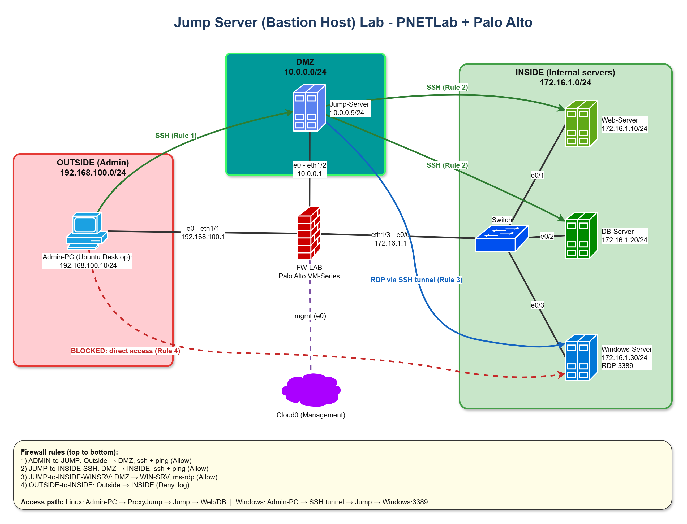
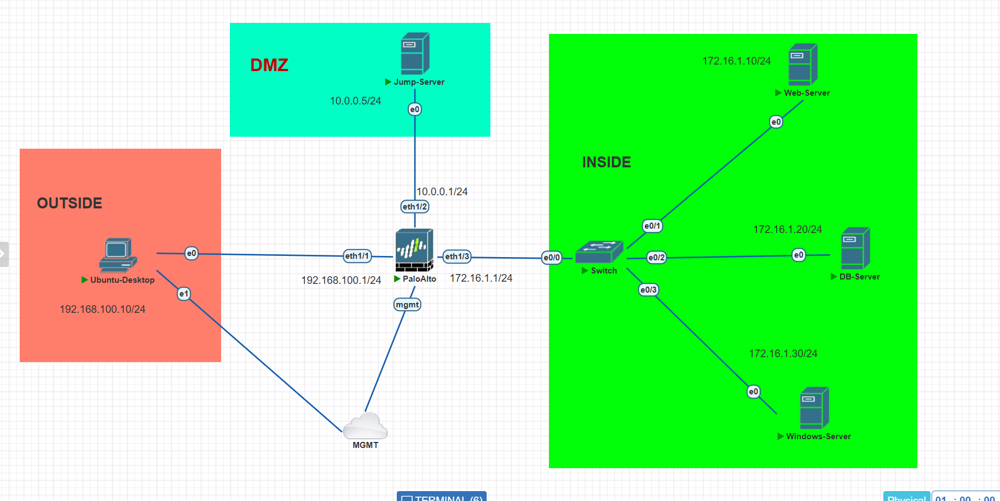
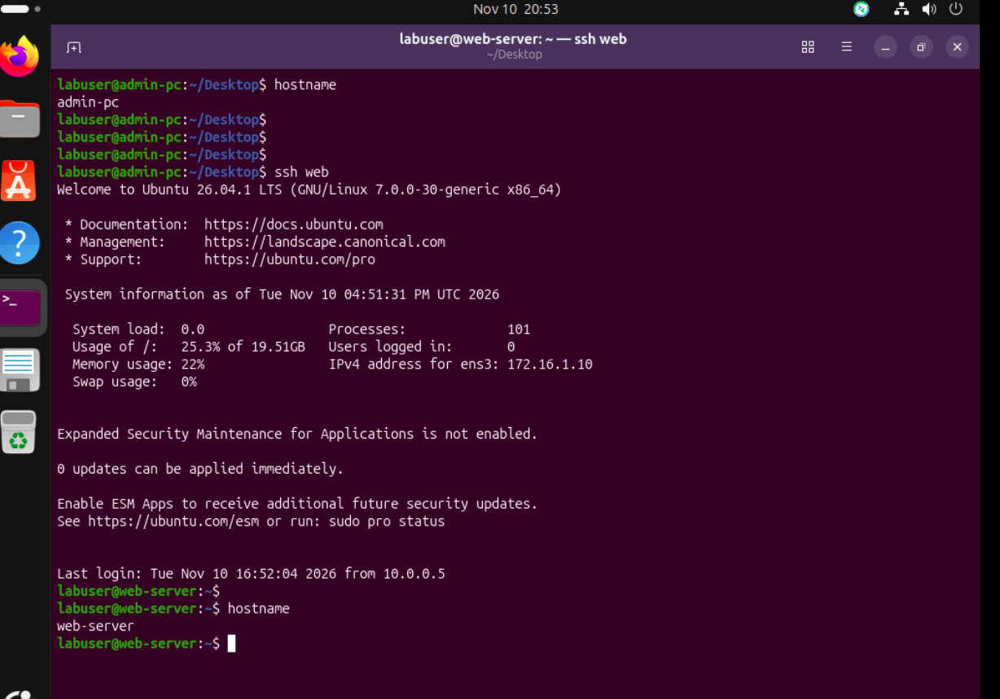
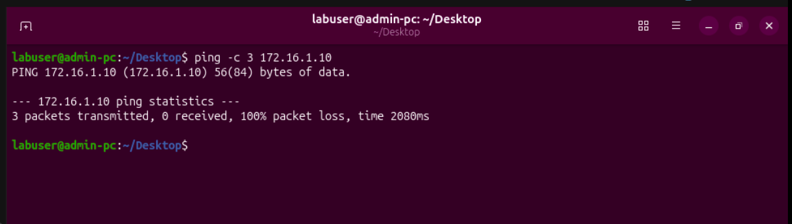
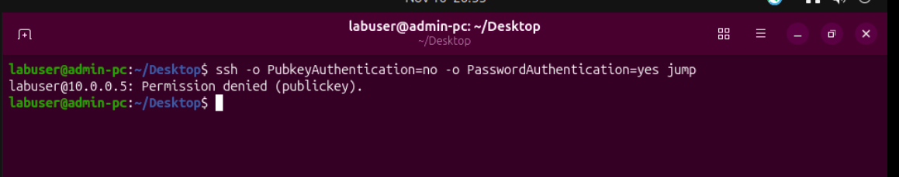
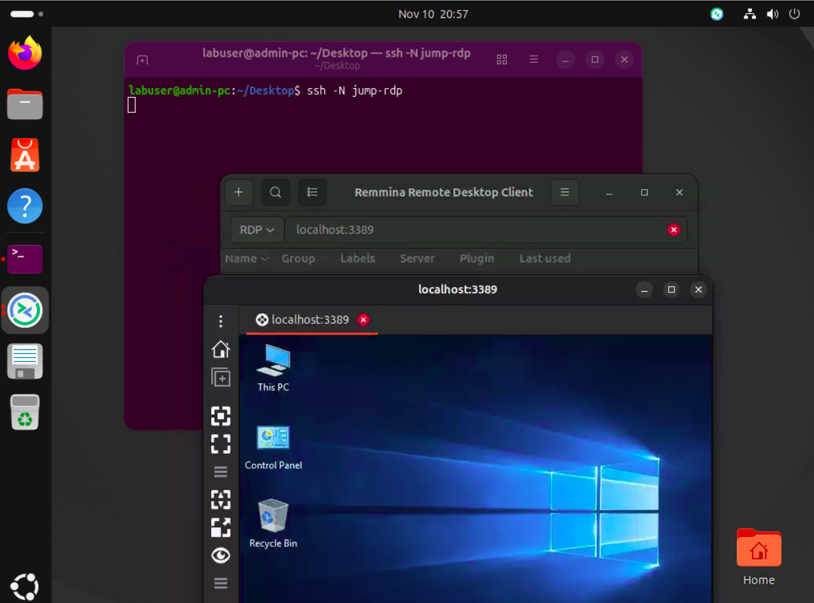
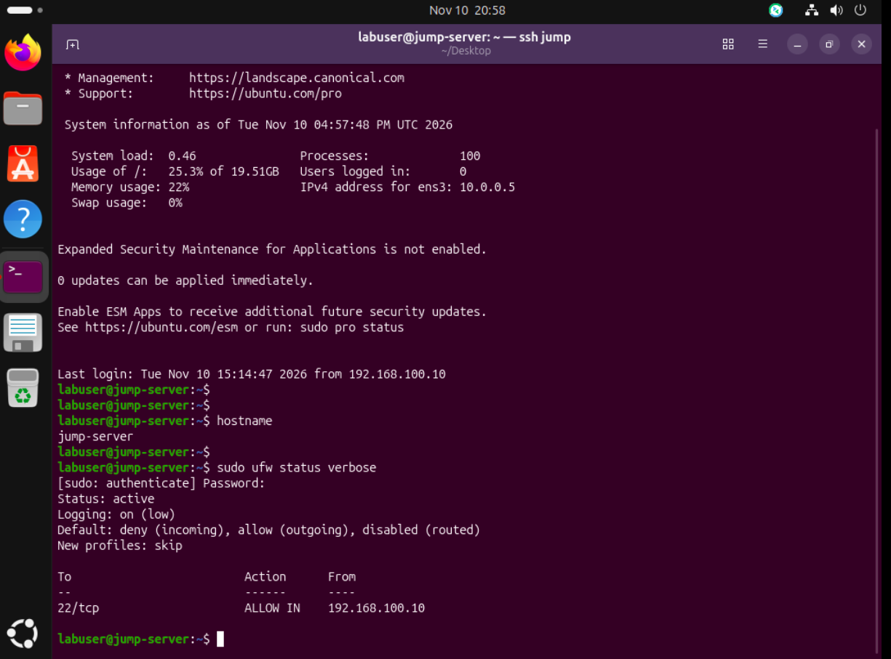
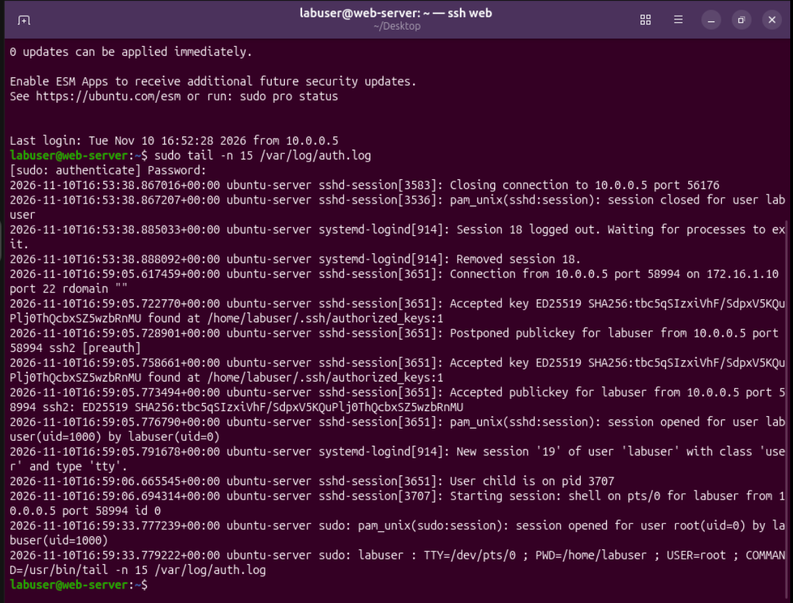
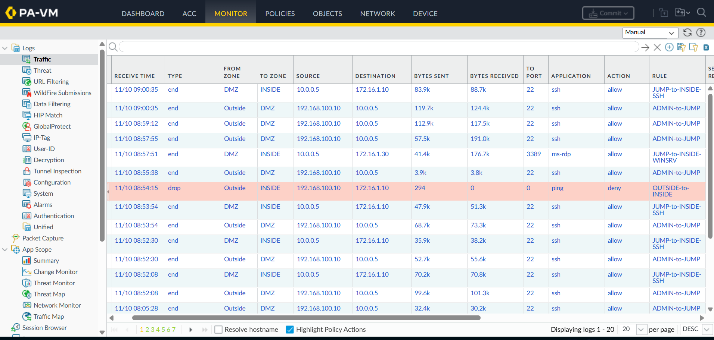

# Jump Server Lab: PNETLab + Palo Alto

English | [Azərbaycanca](README.az.md)

A small network built in PNETLab where the internal servers can only be reached through a single Jump Server. A Palo Alto firewall sits in the middle and decides what is allowed.



## How it works

The network has three zones:

- **Outside** (192.168.100.0/24): the admin workstation.
- **DMZ** (10.0.0.0/24): the Jump Server.
- **INSIDE** (172.16.1.0/24): a web server, a database server and a Windows server.

The admin workstation cannot talk to anything in INSIDE directly. To reach a server, the admin first connects to the Jump Server, and the Jump Server connects onward. The firewall only allows that path, and everything else from Outside to INSIDE is dropped and logged.

## Addressing

| Device | Interface | IP address | Zone |
|---|---|---|---|
| Admin-PC (Ubuntu Desktop) | ens3 | 192.168.100.10/24 | Outside |
| Palo Alto | ethernet1/1 | 192.168.100.1/24 | Outside |
| Palo Alto | ethernet1/2 | 10.0.0.1/24 | DMZ |
| Palo Alto | ethernet1/3 | 172.16.1.1/24 | INSIDE |
| Jump-Server (Ubuntu Server) | ens3 | 10.0.0.5/24 | DMZ |
| Web-Server (Ubuntu Server) | ens3 | 172.16.1.10/24 | INSIDE |
| DB-Server (Ubuntu Server) | ens3 | 172.16.1.20/24 | INSIDE |
| Windows-Server | Ethernet | 172.16.1.30/24 | INSIDE |

The firewall management interface and the admin workstation's second NIC are both attached to a Cloud0 bridge. That is only used for the firewall web GUI and for connecting to the workstation from the host machine. It is not part of the traffic path above.

## Firewall rules

Rules are evaluated from top to bottom, so the deny rule has to stay last.

| # | Name | From | To | Application | Action |
|---|---|---|---|---|---|
| 1 | ADMIN-to-JUMP | Outside, Admin-PC | DMZ, Jump-Server | ssh, ping | Allow |
| 2 | JUMP-to-INSIDE-SSH | DMZ, Jump-Server | INSIDE, 172.16.1.0/24 | ssh, ping | Allow |
| 3 | JUMP-to-INSIDE-WINSRV | DMZ, Jump-Server | INSIDE, Windows-Server | ms-rdp | Allow |
| 4 | OUTSIDE-to-INSIDE | Outside | INSIDE | any | Deny, log |

All rules use `application-default` and log at session end.

## Reaching the servers

### Linux servers

SSH with `ProxyJump`. The client config on the admin workstation:

```sshconfig
Host jump
  HostName 10.0.0.5
  User labuser
  IdentityFile ~/.ssh/id_ed25519

Host web
  HostName 172.16.1.10
  User labuser
  IdentityFile ~/.ssh/id_ed25519
  ProxyJump jump

Host db
  HostName 172.16.1.20
  User labuser
  IdentityFile ~/.ssh/id_ed25519
  ProxyJump jump
```

`ssh web` opens a connection to the Jump Server and continues to the web server from there. The private key stays on the workstation. Agent forwarding is disabled on purpose.

### Windows server

RDP is carried through an SSH tunnel to the Jump Server:

```sshconfig
Host jump-rdp
  HostName 10.0.0.5
  User labuser
  IdentityFile ~/.ssh/id_ed25519
  LocalForward 3389 172.16.1.30:3389
```

```bash
ssh -N jump-rdp
```

Then point an RDP client (Remmina, for example) at `localhost:3389`.

## Hardening

**sshd** (`/etc/ssh/sshd_config.d/00-lab-hardening.conf`):

```
PermitRootLogin no
PasswordAuthentication no
PubkeyAuthentication yes
AllowUsers labuser
MaxAuthTries 3
LoginGraceTime 30
X11Forwarding no
AllowAgentForwarding no
AllowTcpForwarding yes
LogLevel VERBOSE
```

`AllowTcpForwarding` has to stay `yes` on the Jump Server, otherwise ProxyJump and the RDP tunnel stop working. The web and DB servers use the same file without `LoginGraceTime`, `AllowAgentForwarding` and `AllowTcpForwarding`.

The file name starts with `00-` so it is read before `50-cloud-init.conf`. sshd uses the first value it finds, and the cloud-init file can turn password login back on.

**ufw** on each Linux server:

```bash
sudo ufw default deny incoming
sudo ufw default allow outgoing
sudo ufw allow from 192.168.100.10 to any port 22 proto tcp   # Jump-Server: admin only
sudo ufw allow from 10.0.0.5 to any port 22 proto tcp         # Web and DB: Jump-Server only
sudo ufw enable
```

**Windows Firewall:** the Remote Desktop inbound rule is limited to 10.0.0.5.

## Checking that it works

| Test | Expected result |
|---|---|
| `ssh jump` from Admin-PC | Key login succeeds |
| `ssh web`, `ssh db` | Succeed through the Jump Server |
| `ping 172.16.1.10` from Admin-PC | No reply. The firewall logs a `deny` under rule 4 |
| SSH with password only | `Permission denied (publickey)` |
| RDP to `localhost:3389` with the tunnel up | Windows desktop opens |
| `sudo ufw status verbose` | Active, port 22 allowed only from the expected source |

## Screenshots

**PNETLab topology**



**SSH to the web server through the Jump Server**



**Direct access from Admin-PC is blocked**



**Password login is rejected**



**Windows desktop through the SSH tunnel**



**Host firewall on the Jump Server**



**Web server log: the connection comes from the Jump Server**



**Firewall traffic log**



## Logs

- Linux: `/var/log/auth.log` shows accepted keys, failed attempts and sudo commands. On the web and DB servers the source address is always 10.0.0.5, which confirms the connection came through the Jump Server.
- Palo Alto: Monitor > Traffic. Sessions are logged when they end, and timestamps are in UTC.


## Note

Lab environment for learning purposes. The repository contains no real credentials or private keys.
